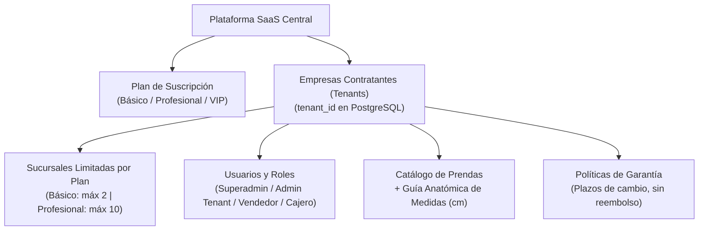

# FashionStore 2do Parcial: Guía de Evolución e Implementación

Esta skill proporciona el marco de trabajo metodológico y técnico para transformar la plataforma **FashionStore** desde el prototipo monocadena del Primer Parcial hacia una plataforma empresarial **SaaS Multitenant**, **Offline-First**, asistida por **IA Generativa y Machine Learning**, modelada rigurosamente bajo **ICONIX** y estándares **UML 2.5+** para la materia **Sistemas de Información 2 (INF-412)** dictada por la **MSc. Ing. Angélica Garzón Cuéllar**.

---

## 1. Visión General del Proyecto y Cronograma de Entregas

El proyecto se desarrolla bajo un calendario de hitos incrementales:

| Hito | Fecha Límite | Enfoque Principal | Estado |
| :--- | :--- | :--- | :--- |
| **Presentación 1** | **25/10/2026** | **SaaS Multitenant, Aislamiento de Datos, Modelado ICONIX (Casos de Uso, Robustez, Clases) y Esquema de Base de Datos PostgreSQL.** | **PRIORIDAD ACTUAL** |
| **Presentación 2** | **01/11/2026** | **Operaciones Offline (PWA Angular + IndexedDB, Flutter + SQLite), Idempotencia, Sincronización, Consistencia de Stock, Devoluciones y Traspasos.** | Siguiente Fase |
| **Presentación 3** | **08/11/2026** | **IA Generativa (Consultas de Lenguaje Natural Texto/Voz), Machine Learning (Supervisado/No supervisado), Dashboards Analíticos y Pruebas.** | Fase Final |
| **Defensa Final** | **10/11/2026 (07:00)** | **Demostración integral end-to-end ante la docente en nube y sustentación de trazabilidad ICONIX.** | Hito de Cierre |

---

## 2. Alcance Prioritario: PRESENTACIÓN 1

Para la **Presentación 1**, el sistema debe dejar operativos y formalmente modelados los cimientos arquitectónicos sobre los cuales descansan todas las operaciones posteriores:

### 2.1. Objetivos Obligatorios de Presentación 1
1. **Modelado ICONIX Fases 1 y 2**:
   - Catálogo de 25 Casos de Uso (CU01 a CU25) con descripción, actores y canal (Web/Móvil).
   - Modelo de Dominio con las nuevas 9 entidades de negocio.
   - Diagramas de Robustez (Boundary-Control-Entity) para los casos de uso fundacionales: CU01 (Planes), CU02 (Empresa Tenant), CU03 (Suscripción), CU04 (Sucursales con límite), CU05 (Autenticación con contexto tenant), CU06 (Catálogo y Guía de medidas) y CU18 (Políticas de garantía).
   - Diagrama de Clases UML 2.5+ sincronizado en Enterprise Architect (`diagramas_2doparcial.eap`).
2. **Base de Datos Multitenant en PostgreSQL**:
   - Tablas base del SaaS: `plan_suscripcion`, `empresa`, `suscripcion`.
   - Tablas de calce y postventa: `guia_medida`, `politica_garantia`, `nota_devolucion`, `detalle_nota_devolucion`.
   - Tablas de logística y offline: `traspaso_inventario`, `detalle_traspaso`, `sincronizacion_offline`, `conflicto_inventario`.
   - Tablas de analítica e IA: `reporte_generativo_ia`, `modelo_analitico_ml`.
   - Inyección de `empresa_id` en las entidades operativas (`usuario`, `sucursal`, `producto`, `proveedor`, `venta`, `reserva`, `bitacora_auditoria`).
   - Seeding con al menos **dos empresas de prueba independientes** (Tenant A y Tenant B) con planes asignados.
3. **Backend Core (FastAPI)**:
   - Middleware de extracción y validación de `tenant_id` (vía JWT o encabezado `X-Tenant-ID`).
   - Inyección automática del contexto tenant en todas las consultas de SQLAlchemy (`WHERE empresa_id = :tenant_id`).
   - Control de límites de sucursales según el plan suscrito (Límite Básico: 2 sucursales; Profesional: 10).
   - Endpoints de autenticación con generación de token portando contexto empresarial.
   - Endpoints para gestión de Catálogo con Guía Anatómica de Medidas en centímetros (`pecho_cm`, `cintura_cm`, `cadera_cm`, `largo_cm`, `manga_cm`).
   - Endpoints para parametrización de Políticas de Garantía (plazo de días de cambio, prohibición de reintegro de dinero).

---

## 3. Procedimiento de Ejecución Paso a Paso (Presentación 1)

Sigue este procedimiento en orden riguroso:

### Paso 1: Configurar la Base de Datos Multitenant
1. Ejecuta el DDL multitenant completo ubicado en [references/database-schema.sql](./references/database-schema.sql).
2. Verifica que todas las tablas troncales posean la clave foránea `empresa_id REFERENCES empresa(id)`.
3. Aplica los datos iniciales ejecutando el script de seeding:
   `python .agents/skills/fashionstore-2doparcial/scripts/seed_presentation1.py`
4. Comprueba que existan los 3 planes (`BASICO`, `INTERMEDIO`/`PROFESIONAL`, `VIP`) y los 2 tenants independientes (`Elegance Boutique` y `Urban Style Trend`).

### Paso 2: Implementar el Middleware Multitenant en FastAPI
1. Configura el extractor de contexto de tenant en `backend/core/tenant.py`. Revisa la implementación de referencia en [examples/fastapi_tenant_middleware.py](./examples/fastapi_tenant_middleware.py).
2. Asegura que ninguna ruta protegida permita consultas directas sin filtrar por `empresa_id`.
3. Implementa la excepción HTTP 403 Forbidden cuando un usuario intente acceder a registros pertenecientes a otro tenant.

### Paso 3: Implementar la Validación de Límites de Plan
1. En el servicio de creación de sucursales (`backend/services/branch_service.py`), consulta la suscripción activa del tenant.
2. Compara el total de sucursales registradas con `plan_suscripcion.limite_sucursales`.
3. Si la empresa cuenta con Plan Básico e intenta crear una tercera sucursal, bloquea la acción con error `400 Bad Request: Límite de sucursales alcanzado para el plan contratado`. Revisa [examples/subscription_limiter.py](./examples/subscription_limiter.py).

### Paso 4: Implementar Guía de Medidas y Políticas de Garantía
1. En el módulo de catálogo, expón endpoints para consultar y registrar `guia_medida` por prenda y talla en centímetros.
2. Expón endpoints para configurar `politica_garantia` por empresa (plazo en días para cambio de talla, regla estricta de no devolución de dinero).
3. Revisa la lógica detallada en [examples/guia_medidas_service.py](./examples/guia_medidas_service.py).

### Paso 5: Verificar Modelado ICONIX en Enterprise Architect
1. Revisa que el archivo `diagramas_2doparcial.eap` contenga el paquete `3.4. Diagrama de clases UML`.
2. Verifica la presencia de las 40 clases originales más las 9 clases nuevas del 2do Parcial (`PlanSuscripcion`, `Empresa`, `Suscripcion`, `GuiaMedida`, `PoliticaGarantia`, `SincronizacionOffline`, `ConflictoInventario`, `ReporteGenerativoIA`, `ModeloAnaliticoML`).
3. Ejecuta el script de verificación y sincronización:
   `powershell -ExecutionPolicy Bypass -File .agents/skills/fashionstore-2doparcial/scripts/ea_model_sync.ps1`

### Paso 6: Ejecutar Pruebas Automatizadas de Aislamiento
1. Corre la suite de pruebas de aislamiento multitenant:
   `python .agents/skills/fashionstore-2doparcial/scripts/verify_multitenant_setup.py`
2. Valida que:
   - Tenant A no puede leer productos, ventas ni usuarios de Tenant B.
   - El límite de sucursales rechaza sobrepasos según el plan.
   - Las guías de medidas en cm quedan asociadas a la empresa correcta.

---

## 4. Hoja de Ruta para Presentaciones 2 y 3

Para mantener coherencia global a lo largo de todo el semestre, la skill ya incluye las especificaciones completas de las siguientes entregas en [references/presentation-roadmap.md](./references/presentation-roadmap.md):

- **Presentación 2 (Offline & Logística)**:
  - Service Worker e IndexedDB en Angular PWA.
  - SQLite (`sqflite`) en Flutter Móvil.
  - Ventas offline de contado con UUIDv4 e idempotencia.
  - Reservas offline para probador físico sin pago.
  - Notas de devolución por cambio de talla (reingreso a inventario y despacho de nueva talla, sin retorno de dinero).
  - Traspasos multi-sucursal en dos fases (solicitud/despacho en tránsito y recepción conforme en destino).
- **Presentación 3 (IA Generativa & Machine Learning)**:
  - Endpoints de consulta en lenguaje natural (texto y voz) con Google Gemini con inyección forzosa de `tenant_id`.
  - Exportación de reportes dinámicos a PDF (ReportLab) y Excel (OpenPyXL).
  - Modelos de Machine Learning (regresión para predicción de demanda de stock y clustering para segmentación RFM de clientes).
  - Dashboard analítico con gráficos interactivos.

---

## 5. Referencias y Recursos Incluidos en la Skill

- [Esquema de Base de Datos PostgreSQL](./references/database-schema.sql)
- [Especificación de Casos de Uso ICONIX (CU01 a CU25)](./references/iconix-specifications.md)
- [Arquitectura de Seguridad Multitenant](./references/multitenant-architecture.md)
- [Contratos de API REST](./references/api-contracts.md)
- [Cronograma Detallado de Hitos y Entregas](./references/presentation-roadmap.md)
