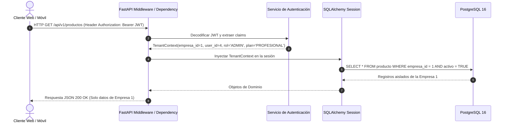

# Arquitectura Multitenant y Seguridad en FashionStore

## 1. Modelo de Multitenancy: Base de Datos Compartida con Aislamiento Lógico

FashionStore adopta el patrón arquitectónico **Shared Database, Shared Schema with Discriminator Column (`tenant_id` / `empresa_id`)**, el cual es el estándar de la industria SaaS para soluciones de alto rendimiento y costo eficiente:

- **Eficiencia en recursos**: Una única base de datos central en PostgreSQL 16 maneja múltiples tenants mediante particionamiento lógico y optimización con índices compuestos (`empresa_id, id`).
- **Aislamiento estricto**: Cada tabla transaccional y de catálogo contiene la columna `empresa_id`.
- **Garantía RNF02**: Ninguna consulta SQL puede ejecutarse en el backend sin incluir en la cláusula WHERE el filtro explícito `empresa_id = :current_tenant`.

---

## 2. Ciclo de Vida de una Petición Multitenant



---

## 3. Estructura del Token JWT con Contexto Multitenant

Cada token de sesión firmado con HMAC-SHA256 (`HS256`) porta la siguiente estructura de payload:

```json
{
  "sub": "4",
  "email": "cajero@eleganceboutique.com",
  "empresa_id": 1,
  "subdominio": "elegance",
  "sucursal_id": 2,
  "rol": "CAJERO",
  "plan_codigo": "INTERMEDIO",
  "permite_offline": true,
  "permite_ia": true,
  "exp": 1793232000,
  "iat": 1793145600
}
```

---

## 4. Reglas de Validación de Límites por Plan

Al registrar sucursales, usuarios o invocar servicios de IA, el backend ejecuta validaciones automáticas:

| Característica | Plan Básico (Emprendedor) | Plan Profesional / Intermedio | Plan Corporativo VIP |
| :--- | :--- | :--- | :--- |
| **Sucursales Activas** | **Máximo 2** | **Máximo 10** | **Ilimitadas** |
| **Operación Offline** | Deshabilitado | Habilitado (PWA / Flutter) | Habilitado |
| **Reportes con IA** | No permitido | Permitido | Permitido (Prioridad alta) |
| **Usuarios Administradores** | 1 | 3 | Ilimitados |

---

## 5. Prevención de Ataques de Acceso Cruzado (Cross-Tenant Leakage)

1. **Denegación por Omisión**: Si una petición a una ruta protegida no porta un `empresa_id` válido y validado criptográficamente en el JWT, el servidor responde inmediatamente con `401 Unauthorized` o `403 Forbidden`.
2. **Validación de Relación Foránea**: Al modificar o consultar una entidad por su ID (ejemplo: `GET /api/v1/sucursales/{id}`), la consulta interna siempre valida ambos campos:
   ```python
   # Correcto: Aislamiento absoluto
   sucursal = db.query(Sucursal).filter(
       Sucursal.id == sucursal_id,
       Sucursal.empresa_id == current_tenant.id
   ).first()
   if not sucursal:
       raise HTTPException(status_code=404, detail="Sucursal no encontrada o no autorizada")
   ```
3. **Imposibilidad de Modificar `empresa_id` en Updates**: Los esquemas Pydantic de entrada (`Schemas`) omiten deliberadamente el campo `empresa_id`, impidiendo que un usuario malicioso envíe un payload para transferir un registro a otra empresa.
