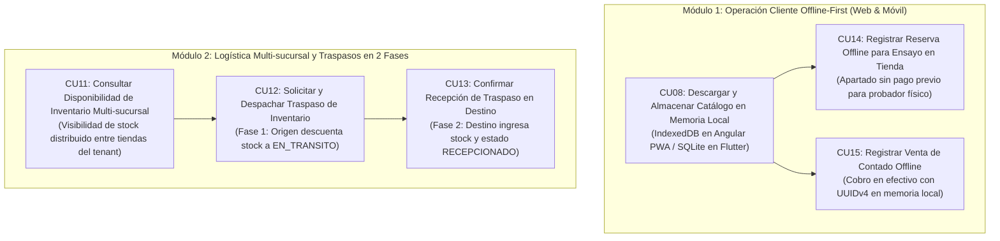

# FashionStore 2do Parcial - Skill Presentación 2 (Parte 1: Casos de Uso CU08 al CU15)

Esta skill está diseñada específicamente para guiarte en el desarrollo, modelado ICONIX y verificación de los **primeros 6 Casos de Uso** de la Presentación 2. Los restantes 5 casos de uso (CU16 al CU20: Sincronización Backend, Conflictos de Stock, Políticas de Garantía y Notas de Devolución) quedan asignados a tu compañero.

---

## 1. Alcance de tu Asignación (Los 6 Casos de Uso)



### Tabla de Responsabilidades de la Parte 1

| # | ID | Caso de Uso | Actores | Canal | Alcance Técnico Concreto |
| :-: | :--- | :--- | :--- | :---: | :--- |
| **1** | **CU08** | **Descargar y Almacenar Catálogo en Memoria Local** | Vendedor / Sistema | Web / Móvil | Endpoint de volcado local + `IndexedDB` en Angular PWA + `sqflite` en Flutter. |
| **2** | **CU11** | **Consultar Disponibilidad de Inventario Multi-sucursal** | Vendedor / Cliente | Web / Móvil | Endpoint `GET /api/v1/inventario/sucursales-stock` con existencias por tienda. |
| **3** | **CU12** | **Solicitar y Despachar Traspaso de Inventario** | Encargado Origen | Web | Endpoint `POST /api/v1/inventario/traspasos` (genera código, rebaja disponible y fija `EN_TRANSITO`). |
| **4** | **CU13** | **Confirmar Recepción de Traspaso en Destino** | Encargado Destino | Web | Endpoint `POST /api/v1/inventario/traspasos/{id}/recepcionar` (suma a destino y fija `RECEPCIONADO`). |
| **5** | **CU14** | **Registrar Reserva Offline para Ensayo en Tienda** | Cliente / Vendedor | Web / Móvil | Guardado local en IndexedDB/SQLite sin exigir pasarela ni cobro de dinero. |
| **6** | **CU15** | **Registrar Venta de Contado Offline** | Cajero / Vendedor | Web / Móvil | Generación de clave local `UUIDv4`, descuento del catálogo local y emisión de ticket contingente. |

---

## 2. Hoja de Ruta de Implementación Paso a Paso

Sigue este orden cronológico para completar tus 6 Casos de Uso:

### Paso 1: Backend de Traspasos y Consulta Multi-sucursal (FastAPI)
1. **Endpoint CU11 (`GET /api/v1/inventario/sucursales-stock`)**:
   - Recibe `variante_id`.
   - Consulta las existencias en todas las sucursales pertenecientes al mismo `empresa_id`.
   - Retorna: Nombre de sucursal, dirección, teléfono y stock disponible.
2. **Endpoint CU12 - Fase 1 Despacho (`POST /api/v1/inventario/traspasos`)**:
   - Valida que `sucursal_origen_id <> sucursal_destino_id`.
   - Verifica existencias en origen.
   - Descuenta stock de origen y crea el registro en `traspaso_inventario` con `estado = 'EN_TRANSITO'`.
3. **Endpoint CU13 - Fase 2 Recepción (`POST /api/v1/inventario/traspasos/{id}/recepcionar`)**:
   - Valida que el traspaso esté en `EN_TRANSITO`.
   - Incrementa el stock disponible en la sucursal de destino.
   - Actualiza el traspaso a `RECEPCIONADO`.
4. **Endpoint para Descarga de Catálogo CU08 (`GET /api/v1/catalogo/sincronizar-local`)**:
   - Retorna la lista consolidada de productos, precios, variantes y guías de medidas en cm para ser consumidas por Angular y Flutter.

### Paso 2: Frontend Web - PWA e IndexedDB (Angular)
1. **Configuración de IndexedDB (`FashionStoreLocalDB`)**:
   - Implementa los object stores: `catalogo`, `ventas_offline` y `reservas_offline`.
   - Revisa el servicio listo en [examples/angular_local_offline_service.ts](./examples/angular_local_offline_service.ts).
2. **Implementación de CU08 (Descarga de Catálogo)**:
   - Botón o sincronizador inicial que llama a `guardarCatalogoLocal()` con los datos del servidor.
3. **Implementación de CU14 (Reserva para Probador Físico)**:
   - Botón en la ficha de producto: *"Apartar para Probador (Sin Pago)"*.
   - Almacena en `reservas_offline` con UUIDv4 y muestra confirmación con código de vestidor.
4. **Implementación de CU15 (Venta de Contado Offline)**:
   - En la pantalla de POS/Caja, si el navegador detecta `navigator.onLine === false`, habilita el cobro de contingencia en efectivo.
   - Genera UUIDv4 (`crypto.randomUUID()`), descuenta el stock local en IndexedDB y guarda la venta.

### Paso 3: Aplicación Móvil - Persistencia Local (Flutter + SQLite)
1. **Configuración de `sqflite`**:
   - Implementa las tablas locales `local_catalog`, `offline_sales` y `offline_reservations`.
   - Revisa el helper en [examples/flutter_local_storage_helper.dart](./examples/flutter_local_storage_helper.dart).
2. **Flujo Móvil de Contingencia**:
   - Métodos `recordOfflineSale()` (CU15) y `recordOfflineReservation()` (CU14) para cuando el dispositivo no tenga WiFi ni datos móviles.

### Paso 4: Sincronización en Enterprise Architect (`diagramas_2doparcial.eap`)
1. Ejecuta el script automatizado para crear los paquetes y objetos BCE de tus 6 casos de uso:
   ```powershell
   powershell -ExecutionPolicy Bypass -File .agents/skills/fashionstore-p2-parte1/scripts/sync_ea_p2_parte1.ps1
   ```

### Paso 5: Verificación Automatizada de tus 6 Casos de Uso
1. Corre la suite de pruebas unitarias y de lógica:
   ```bash
   "C:\Program Files\PostgreSQL\18\pgAdmin 4\python\python.exe" .agents/skills/fashionstore-p2-parte1/scripts/verify_p2_parte1.py
   ```
2. Comprueba que las 6 pruebas específicas pasen al 100% OK.

---

## 3. Delimitación con el Trabajo de tu Compañero

Para evitar solapamientos y asegurar una integración limpia, esta es la frontera de responsabilidades:

| Tu Trabajo (Parte 1: CU08 al CU15) | Trabajo de tu Compañero (Parte 2: CU16 al CU20) |
| :--- | :--- |
| Almacenar catálogo en IndexedDB / SQLite (CU08). | Diseñar la cola y enviar el lote al reconectar (CU16). |
| Registrar ventas locales con UUIDv4 (CU15). | Validar idempotencia y deducción central en PostgreSQL (CU16). |
| Registrar reservas sin pago para probador (CU14). | Resolver quiebres de inventario en `conflicto_inventario` (CU17). |
| Consultar existencias multi-sucursal (CU11). | Configurar políticas de garantía del tenant (CU18). |
| Despachar traspaso en origen como `EN_TRANSITO` (CU12). | Registrar solicitudes de cambio de talla (CU19). |
| Recepcionar traspaso conforme como `RECEPCIONADO` (CU13). | Emitir la Nota de Devolución con 0 reembolso monetario (CU20). |

---

## 4. Recursos Incluidos en esta Skill

- [Especificación ICONIX de los 6 Casos de Uso (BCE y Secuencia)](./references/iconix-specifications-p2-parte1.md)
- [Guía Cliente Angular PWA e IndexedDB](./references/pwa-angular-client-guide.md)
- [Guía Cliente Flutter SQLite](./references/flutter-mobile-client-guide.md)
- [Guía Backend de Traspasos y Stock Multi-sucursal](./references/multibranch-transfers-guide.md)
- [Servicio Angular IndexedDB (TypeScript)](./examples/angular_local_offline_service.ts)
- [Helper SQLite Flutter (Dart)](./examples/flutter_local_storage_helper.dart)
- [Endpoints FastAPI para Traspasos y Stock](./examples/fastapi_traspasos_and_stock_routes.py)
- [Script de Pruebas Automatizadas (Parte 1)](./scripts/verify_p2_parte1.py)
- [Script de Sincronización Enterprise Architect (Parte 1)](./scripts/sync_ea_p2_parte1.ps1)
