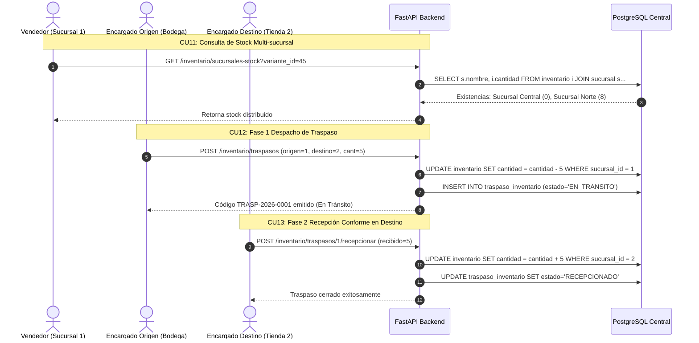

# Guía Técnica: Inventario Multi-sucursal y Traspasos en Dos Fases (CU11, CU12, CU13)

## 1. Visión General de la Logística Multi-sucursal

En FashionStore SaaS, cada tenant cuenta con múltiples sucursales activas (según su plan de suscripción). La gestión de stock debe ser transparente entre tiendas y permitir el traslado formal de mercadería en dos fases auditadas.



---

## 2. Especificación de Endpoints

### 2.1. CU11: Consultar Disponibilidad de Inventario Multi-sucursal
- **Método**: `GET`
- **Ruta**: `/api/v1/inventario/sucursales-stock`
- **Query Params**: `variante_id` (int)
- **Seguridad**: Autenticado (filtra estrictamente por `empresa_id` del usuario).
- **Respuesta JSON**:
```json
[
  {
    "sucursal_id": 1,
    "nombre_sucursal": "Sucursal Central - Casco Viejo",
    "direccion": "Calle 21 de Mayo #340",
    "telefono": "3345678",
    "stock_disponible": 0
  },
  {
    "sucursal_id": 2,
    "nombre_sucursal": "Sucursal Norte - Equipetrol",
    "direccion": "Av. San Martín #1200",
    "telefono": "3398765",
    "stock_disponible": 8
  }
]
```

---

### 2.2. CU12: Solicitar y Despachar Traspaso (Fase 1: Origen)
- **Método**: `POST`
- **Ruta**: `/api/v1/inventario/traspasos`
- **Validaciones**:
  1. `sucursal_origen_id <> sucursal_destino_id`.
  2. `inventario.cantidad >= cantidad_a_enviar`.
- **Acción Transaccional**:
  - Resta las unidades del stock disponible de la sucursal de origen.
  - Inserta el registro en `traspaso_inventario` con `estado = 'EN_TRANSITO'`.
  - Inserta en `detalle_traspaso`.
- **Payload Request**:
```json
{
  "sucursal_origen_id": 1,
  "sucursal_destino_id": 2,
  "motivo": "Reabastecimiento de urgencia",
  "items": [
    {
      "producto_variante_id": 45,
      "cantidad": 5
    }
  ]
}
```

---

### 2.3. CU13: Confirmar Recepción de Traspaso en Destino (Fase 2: Destino)
- **Método**: `POST`
- **Ruta**: `/api/v1/inventario/traspasos/{traspaso_id}/recepcionar`
- **Validaciones**:
  1. El traspaso debe encontrarse en estado `EN_TRANSITO`.
  2. El usuario debe pertenecer a la sucursal de destino o ser Administrador de Tenant.
- **Acción Transaccional**:
  - Suma las unidades recibidas al stock disponible de la sucursal de destino.
  - Actualiza `traspaso_inventario.estado = 'RECEPCIONADO'`.
  - Registra fecha y usuario receptor.
- **Payload Request**:
```json
{
  "observaciones_recepcion": "Mercadería recibida en perfectas condiciones",
  "items_confirmados": [
    {
      "producto_variante_id": 45,
      "cantidad_recibida": 5
    }
  ]
}
```
