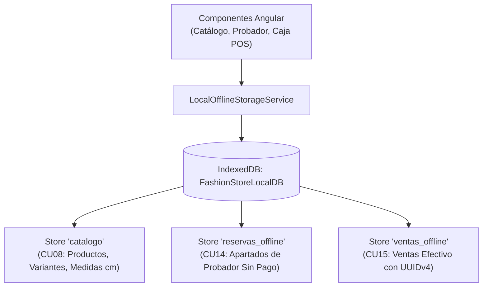

# Guía Técnica: Cliente Angular PWA (CU08, CU14, CU15)

## 1. Arquitectura de Almacenamiento Local (IndexedDB)

Para cumplir con la operación sin conexión exigida en la Presentación 2, la aplicación web Angular debe disponer de una base de datos IndexedDB local llamada `FashionStoreLocalDB` (versión 1).

### Estructura de Object Stores Necesarios:
1. `catalogo` (KeyPath: `id`): Guarda prendas, variantes, precios y tallas para CU08.
2. `reservas_offline` (KeyPath: `uuid`): Guarda apartados para probador físico para CU14.
3. `ventas_offline` (KeyPath: `uuid`): Guarda ventas en efectivo de contingencia para CU15.



---

## 2. Implementación de CU08 (Descarga y Caché de Catálogo)

### Flujo de Descarga:
```typescript
// En catalogo.service.ts
descargarCatálogoParaModoOffline(): Observable<boolean> {
  return this.http.get<any[]>('/api/v1/catalogo/sincronizar-local').pipe(
    switchMap(productos => this.offlineStorage.guardarCatalogoLocal(productos)),
    tap(() => console.log('Catálogo almacenado en IndexedDB con éxito'))
  );
}
```

---

## 3. Implementación de CU14 (Reserva para Probador Físico Sin Pago)

### Lógica de Negocio:
- El cliente no abona seña ni introduce tarjeta de crédito.
- La reserva se persiste en el store local `reservas_offline`:

```typescript
// En probador.component.ts
solicitarApartadoProbador(prendaId: number, horaEstimada: string) {
  const nuevaReserva = {
    uuid: crypto.randomUUID(),
    prenda_id: prendaId,
    hora_ensayo: horaEstimada,
    requiere_pago: false,
    monto: 0.00,
    fecha_creacion: new Date().toISOString(),
    estado: 'PENDIENTE_ENSAYO'
  };

  this.offlineStorage.guardarReservaProbador(nuevaReserva).subscribe(() => {
    alert(`Prenda apartada con éxito. Código de probador: ${nuevaReserva.uuid.substring(0, 8)}`);
  });
}
```

---

## 4. Implementación de CU15 (Venta de Contado Offline)

### Lógica de Cobro de Contingencia:
1. Validar que la forma de pago sea `EFECTIVO`.
2. Generar `uuid = crypto.randomUUID()`.
3. Rebajar las unidades del catálogo local en IndexedDB.
4. Persistir en el store local `ventas_offline`.
5. Emitir comprobante impreso de contingencia.

```typescript
// En pos-caja.component.ts
procesarCobroOffline(itemsCarrito: any[], totalBs: number) {
  const ventaLocal = {
    uuid: crypto.randomUUID(),
    tipo: 'VENTA_CONTADO_EFECTIVO',
    total: totalBs,
    items: itemsCarrito,
    fecha: new Date().toISOString(),
    modo: 'OFFLINE_CONTINGENCIA'
  };

  this.offlineStorage.guardarVentaContingencia(ventaLocal).subscribe(() => {
    // Imprimir ticket de contingencia
    this.imprimirTicketContingencia(ventaLocal);
  });
}
```
