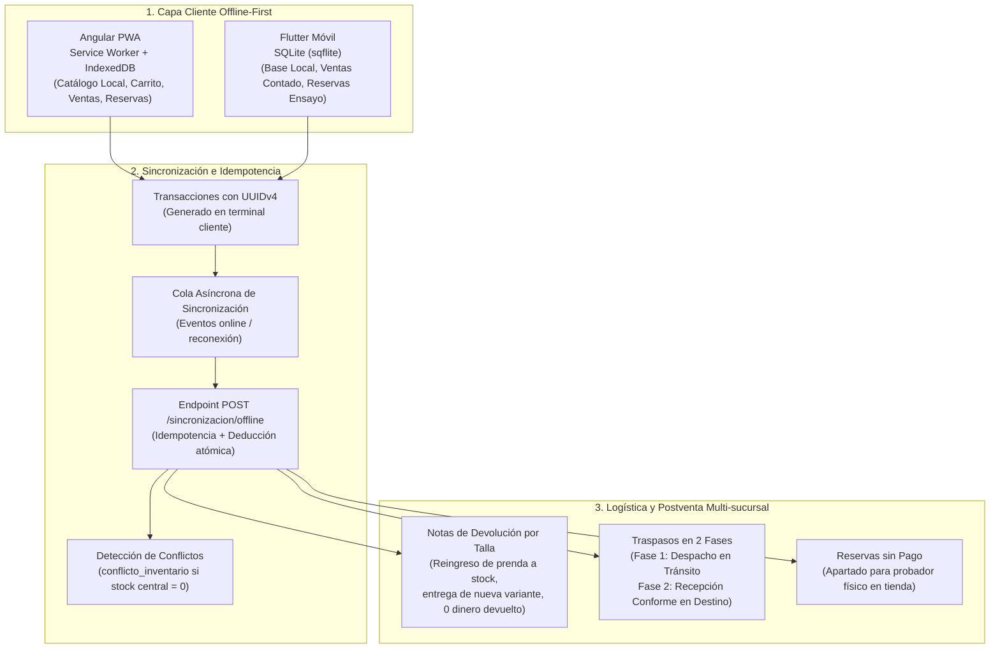

# FashionStore 2do Parcial - Skill Presentación 2: Offline, Logística y Postventa

Esta skill proporciona el marco técnico, código fuente de referencia, modelos ICONIX (Robustez BCE y Secuencia) y scripts de automatización para implementar y defender exitosamente la **Presentación 2 (Hito del 01/11/2026)** de la plataforma **FashionStore SaaS Multitenant** ante la docente **MSc. Ing. Angélica Garzón Cuéllar**.

---

## 1. Alcance y Requisitos Críticos de la Presentación 2

Basado en las directrices de la cátedra y las grabaciones de requisitos del examen, la Presentación 2 exige la implementación de cinco pilares fundamentales:



### 1.1. Resumen de Requerimientos Obligatorios

| Pilar | Requisito Técnico | Componente / Tecnología | Criterio de Aceptación Docente |
| :--- | :--- | :--- | :--- |
| **PWA Web** | Catálogo offline y ventas de contingencia | Angular + `@angular/service-worker` + IndexedDB | Al cortar WiFi, el vendedor sigue buscando prendas y cobrando en efectivo. |
| **Móvil** | Base de datos local transaccional | Flutter + `sqflite` + `path_provider` | Si la app móvil se cierra sin red, las ventas y reservas persisten en SQLite. |
| **Sincronización** | Idempotencia y resolución de stock | FastAPI + PostgreSQL `sincronizacion_offline` | Reenviar el mismo lote 3 veces no duplica ventas ni descuenta doble stock. |
| **Garantías** | Nota de devolución por cambio de talla | FastAPI `nota_devolucion` + regla de negocio | Prenda reingresa al inventario, se entrega la nueva talla, balance monetario = 0. |
| **Traspasos** | Logística multi-sucursal en 2 fases | FastAPI `traspaso_inventario` | Sucursal A descuenta stock a "en tránsito"; Sucursal B lo suma al recepcionar. |
| **ICONIX** | Trazabilidad y diagramas BCE / Secuencia | Enterprise Architect `diagramas_2doparcial.eap` | Paquetes de Robustez y Secuencia para los 10 CU de la Presentación 2. |

---

## 2. Mapa de Casos de Uso ICONIX (Presentación 2)

| ID | Nombre del Caso de Uso | Actores | Canal | Foco Metodológico |
| :--- | :--- | :--- | :--- | :--- |
| **CU08** | Descargar y Almacenar Catálogo en Memoria Local | Vendedor / Sistema | Web / Móvil | Caché en IndexedDB (Angular PWA) y base de datos local SQLite (Flutter). |
| **CU11** | Consultar Disponibilidad de Inventario Multi-sucursal | Vendedor / Cliente | Web / Móvil | Visualización del stock disponible distribuido en todas las sucursales del tenant. |
| **CU12** | Solicitar y Despachar Traspaso de Inventario | Encargado Origen | Web | Fase 1 del Traspaso: Generación de la orden, egreso de bodega y estado EN_TRANSITO. |
| **CU13** | Confirmar Recepción de Traspaso en Destino | Encargado Destino | Web | Fase 2 del Traspaso: Verificación física y recepción en bodega con estado RECEPCIONADO. |
| **CU14** | Registrar Reserva Offline para Ensayo en Tienda | Cliente / Vendedor | Web / Móvil | Apartado de prendas sin pago previo para probador físico en ausencia de internet. |
| **CU15** | Registrar Venta de Contado Offline | Cajero / Vendedor | Web / Móvil | Venta en tienda física sin conectividad, generando clave local con UUIDv4. |
| **CU16** | Sincronizar Operaciones Comerciales Offline | Sistema / Cajero | Web / Móvil | Cola de salida y envío por lotes al reconectar con procesamiento idempotente. |
| **CU17** | Resolver Conflictos de Consistencia de Inventario | Admin Sucursal | Web / Móvil | Gestión y arbitraje en conflicto_inventario si el stock se agotó en el servidor central. |
| **CU18** | Configurar Políticas y Plazos de Cambio de Prenda | Admin Tenant | Web | Parametrización del plazo (ej. 7 días / 48 hrs) y regla estricta de 0 reembolso de dinero. |
| **CU19** | Registrar Solicitud de Cambio de Prenda por Medida | Cliente / Cajero | Web / Móvil | Verificación de plazos de vigencia, motivo (talla/medidas anatómicas) y comprobante. |
| **CU20** | Emitir Nota de Devolución y Reingreso a Inventario | Cajero | Web | Emisión formal de Nota de Devolución, reingreso a inventario y entrega de nueva talla sin dinero. |

---

## 3. Guía de Implementación Paso a Paso

Para implementar la Presentación 2 de forma modular e impecable, sigue las siguientes 5 fases operativas:

### Fase 1: Backend - Sincronización, Devoluciones y Traspasos (FastAPI)
1. **Verificar Tablas en PostgreSQL**:
   Asegúrate de que las tablas `sincronizacion_offline`, `conflicto_inventario`, `politica_garantia`, `nota_devolucion`, `detalle_nota_devolucion`, `traspaso_inventario` y `detalle_traspaso` estén creadas con la discriminación `empresa_id`.
   *(Ver referencia: [references/backend-sync-logistics.md](./references/backend-sync-logistics.md))*.
2. **Implementar los Modelos y Schemas**:
   Copia e integra los esquemas Pydantic y modelos SQLAlchemy provistos en [examples/fastapi_p2_routes.py](./examples/fastapi_p2_routes.py) en los dominios `ventas`, `inventario` y `saas`.
3. **Endpoint de Sincronización Idempotente (`POST /api/v1/sincronizacion/offline`)**:
   - Comprueba unicidad de `uuid_operacion`.
   - Si ya está registrado, retorna respuesta cached (`200 OK`) sin re-procesar.
   - Si no existe, ejecuta en transacción atómica: deducción de existencias en `inventario` o registro en `conflicto_inventario` si stock insuficiente.
4. **Endpoint de Notas de Devolución (`POST /api/v1/devoluciones/notas`)**:
   - Valida que la venta original no exceda `politica_garantia.plazo_dias_cambio`.
   - Reingresa `variante_devuelta_id` al inventario de la sucursal (`+cantidad`).
   - Descuenta `variante_entregada_id` del inventario de la sucursal (`-cantidad`).
   - Aplica regla RN07: `diferencia_monetaria = 0.00` (prohibido devolver efectivo).
5. **Endpoints de Traspasos en 2 Fases**:
   - `POST /api/v1/inventario/traspasos`: Descuenta de origen y marca lote como `EN_TRANSITO`.
   - `POST /api/v1/inventario/traspasos/{id}/recepcionar`: Suma a destino y marca como `RECEPCIONADO`.

### Fase 2: Frontend Web - Angular PWA e IndexedDB
1. **Habilitar PWA en Angular**:
   - Asegúrate de tener registrado `@angular/service-worker` y el archivo `ngsw-config.json` para almacenamiento en caché de assets y catálogo.
2. **Implementar Servicio IndexedDB**:
   - Utiliza el servicio de referencia [examples/angular_offline_service.ts](./examples/angular_offline_service.ts).
   - Crea los object stores: `catalogo`, `ventas_offline`, `reservas_offline`, `sync_queue`.
3. **Mecanismo de Detección de Red y Sincronización**:
   - Escuchar `fromEvent(window, 'online')` y disparar automáticamente el vaciado de `sync_queue`.
   - Mostrar banner visual en barra superior: 🟢 Conectado / 🔴 Modo Offline (Operando con memoria local).

### Fase 3: Aplicación Móvil - Flutter y SQLite (sqflite)
1. **Configurar Dependencias en `pubspec.yaml`**:
   ```yaml
   dependencies:
     sqflite: ^2.3.3+1
     path: ^1.9.0
     uuid: ^4.4.0
     connectivity_plus: ^6.0.3
   ```
2. **Implementar Base de Datos Local**:
   - Integrar la clase `OfflineDatabaseHelper` provista en [examples/flutter_offline_db.dart](./examples/flutter_offline_db.dart).
   - Crear tablas locales SQLite: `local_catalog`, `offline_sales`, `offline_reservations`, `sync_queue`.
3. **Pantalla de Contingencia y Cobro en Efectivo**:
   - Guardar cada venta con `Uuid().v4()`.
   - Sincronizar en segundo plano cuando `connectivity_plus` detecte conexión WiFi/Datos.

### Fase 4: Modelado ICONIX en Enterprise Architect (`diagramas_2doparcial.eap`)
1. Ejecutar el script automatizado de sincronización de diagramas ICONIX:
   ```powershell
   powershell -ExecutionPolicy Bypass -File .agents/skills/fashionstore-presentacion2/scripts/sync_ea_p2_iconix.ps1
   ```
2. Validar que el archivo `.eap` contenga:
   - Paquete `3.2. Diagramas de Robustez (P2)` con diagramas BCE para CU08, CU12, CU13, CU14, CU15, CU16, CU19, CU20.
   - Paquete `3.3. Diagramas de Secuencia (P2)` con asignación estricta de métodos a clases.

### Fase 5: Pruebas Automatizadas y Verificación End-to-End
1. Cargar datos de prueba de multi-sucursal y garantías:
   ```bash
   "C:\Program Files\PostgreSQL\18\pgAdmin 4\python\python.exe" .agents/skills/fashionstore-presentacion2/scripts/seed_presentation2.py
   ```
2. Ejecutar la batería de pruebas de Presentación 2:
   ```bash
   "C:\Program Files\PostgreSQL\18\pgAdmin 4\python\python.exe" .agents/skills/fashionstore-presentacion2/scripts/verify_presentation2.py
   ```
3. Comprobar que los 6 escenarios pasen con éxito (`100% OK`):
   - Prueba 1: Venta offline y sincronización con UUIDv4.
   - Prueba 2: Idempotencia (reintento del mismo UUIDv4 sin duplicar venta ni stock).
   - Prueba 3: Detección de conflicto cuando stock central es insuficiente.
   - Prueba 4: Reserva física para probador sin pago.
   - Prueba 5: Emisión de Nota de Devolución por cambio de talla con reingreso al stock.
   - Prueba 6: Traspaso en 2 fases entre sucursales de la misma empresa.

---

## 4. Recursos y Referencias Incluidas

- [Especificación Completa ICONIX P2 (BCE y Secuencia)](./references/p2-iconix-specifications.md)
- [Guía Arquitectónica Angular PWA e IndexedDB](./references/offline-pwa-guide.md)
- [Guía Arquitectónica Flutter y SQLite](./references/offline-flutter-guide.md)
- [Contratos de API y Lógica de Negocio Backend](./references/backend-sync-logistics.md)
- [Ejemplo de Servicio IndexedDB (TypeScript)](./examples/angular_offline_service.ts)
- [Ejemplo de Base de Datos SQLite (Flutter Dart)](./examples/flutter_offline_db.dart)
- [Ejemplo de Endpoints y Servicios FastAPI](./examples/fastapi_p2_routes.py)
- [Script de Seeding de Presentación 2](./scripts/seed_presentation2.py)
- [Script de Pruebas Automatizadas P2](./scripts/verify_presentation2.py)
- [Script de Sincronización Enterprise Architect P2](./scripts/sync_ea_p2_iconix.ps1)
