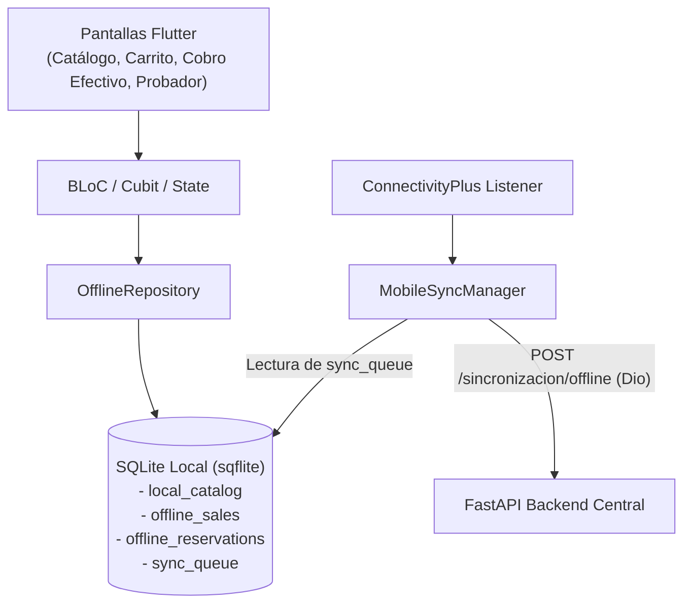

# Guía de Implementación: Flutter Móvil con SQLite (sqflite)

## 1. Arquitectura Móvil Offline-First

En la aplicación móvil desarrollada en Flutter, la resiliencia operativa ante la pérdida de señal 4G/5G o WiFi se garantiza mediante una base de datos local SQLite empotrada a través del plugin `sqflite`.



---

## 2. Dependencias en `pubspec.yaml`

Agrega las siguientes dependencias al archivo `movil/pubspec.yaml`:

```yaml
dependencies:
  flutter:
    sdk: flutter
  sqflite: ^2.3.3+1
  path_provider: ^2.1.3
  path: ^1.9.0
  uuid: ^4.4.0
  connectivity_plus: ^6.0.3
  dio: ^5.4.3+1
```

---

## 3. Esquema de Tablas SQLite

La base de datos local `fashionstore_local.db` contiene las siguientes 4 tablas operativas:

### 3.1. `local_catalog`
Almacena la copia local de productos y tallas descargada periódicamente desde el servidor:
```sql
CREATE TABLE local_catalog (
    id INTEGER PRIMARY KEY,
    nombre TEXT NOT NULL,
    categoria TEXT,
    precio REAL NOT NULL,
    talla TEXT NOT NULL,
    color TEXT,
    stock_disponible INTEGER NOT NULL,
    pecho_cm REAL,
    cintura_cm REAL,
    cadera_cm REAL,
    largo_cm REAL,
    imagen_url TEXT
);
```

### 3.2. `offline_sales`
Registra ventas completadas en efectivo sin conexión:
```sql
CREATE TABLE offline_sales (
    uuid TEXT PRIMARY KEY,
    sucursal_id INTEGER NOT NULL,
    cliente_id INTEGER NOT NULL,
    monto_total REAL NOT NULL,
    metodo_pago TEXT NOT NULL DEFAULT 'EFECTIVO',
    fecha_registro TEXT NOT NULL,
    items_json TEXT NOT NULL,
    estado_sync TEXT NOT NULL DEFAULT 'PENDIENTE'
);
```

### 3.3. `offline_reservations`
Registra apartados de prendas para probador físico en tienda sin pago previo:
```sql
CREATE TABLE offline_reservations (
    uuid TEXT PRIMARY KEY,
    sucursal_id INTEGER NOT NULL,
    cliente_id INTEGER NOT NULL,
    fecha_reserva TEXT NOT NULL,
    hora_ensayo TEXT NOT NULL,
    items_json TEXT NOT NULL,
    estado_sync TEXT NOT NULL DEFAULT 'PENDIENTE'
);
```

### 3.4. `sync_queue`
Cola unificada de despacho al servidor:
```sql
CREATE TABLE sync_queue (
    uuid TEXT PRIMARY KEY,
    tipo_operacion TEXT NOT NULL, -- 'VENTA_LOCAL' o 'RESERVA_LOCAL'
    payload_json TEXT NOT NULL,
    fecha_creacion TEXT NOT NULL,
    reintentos INTEGER DEFAULT 0,
    ultimo_error TEXT
);
```

---

## 4. Flujo de Venta de Contado Offline

1. El usuario selecciona productos en el carrito.
2. Si `connectivity_result == ConnectivityResult.none`:
   - Se muestra un banner informativo: *"Sin conexión - Cobro en efectivo habilitado"*.
   - El vendedor selecciona "Cobrar en Efectivo".
   - Se genera un UUID: `final uuid = const Uuid().v4();`.
   - Se descuenta el stock en la tabla `local_catalog`.
   - Se inserta el registro en `offline_sales` y en `sync_queue`.
   - La pantalla muestra el recibo digital con la leyenda: *"Comprobante local emitido fuera de línea. UUID: {uuid}"*.

---

## 5. Detección Automática de Conectividad y Sincronización

```dart
class ConnectivitySyncService {
  final Connectivity _connectivity = Connectivity();
  final MobileSyncManager _syncManager = MobileSyncManager();

  void initListener() {
    _connectivity.onConnectivityChanged.listen((ConnectivityResult result) {
      if (result != ConnectivityResult.none) {
        // Red restablecida: disparar sincronización de cola
        _syncManager.syncPendingOperations();
      }
    });
  }
}
```

Al sincronizar:
- Se lee `SELECT * FROM sync_queue ORDER BY fecha_creacion ASC`.
- Se envía mediante petición HTTP `Dio().post('/api/v1/sincronizacion/offline', data: batchData)`.
- Si el backend confirma con `200 OK`, se eliminan los UUIDs de `sync_queue` y se actualiza `offline_sales` a `SINCRONIZADO`.
