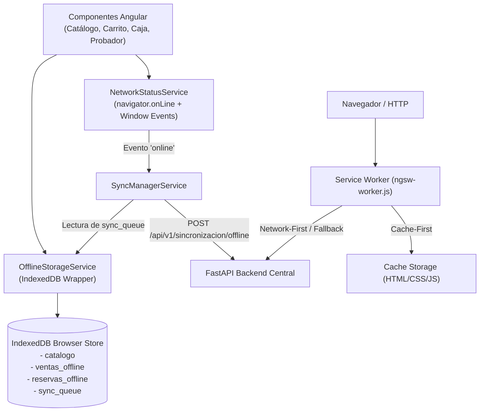

# Guía de Implementación: Angular PWA e IndexedDB (Offline-First)

## 1. Arquitectura de la Solución PWA

Para la **Presentación 2**, la aplicación web Angular debe transformarse en una **Progressive Web App (PWA)** totalmente operativa sin conexión mediante dos capas de tecnología:
1. **Service Worker (`@angular/service-worker`)**: Intercepta peticiones HTTP, almacena en caché recursos estáticos (HTML, JS, CSS, imágenes y fuentes) y sirve la aplicación incluso con el cable de red desconectado o modo avión.
2. **IndexedDB (Base de Datos Local del Navegador)**: Almacén NoSQL estructurado y transaccional que persiste el catálogo de prendas, la cola de ventas offline de contado y las reservas de probador físico.



---

## 2. Configuración del Service Worker en Angular

### 2.1. Instalación del paquete PWA
Si el proyecto aún no tiene el Service Worker configurado:
```bash
ng add @angular/pwa --project fashionstore-frontend
```

### 2.2. Configuración de `ngsw-config.json`
El archivo debe cachear los activos estáticos y definir la estrategia de datos:

```json
{
  "$schema": "./node_modules/@angular/service-worker/config/schema.json",
  "index": "/index.html",
  "assetGroups": [
    {
      "name": "app",
      "installMode": "prefetch",
      "resources": {
        "files": [
          "/favicon.ico",
          "/index.html",
          "/manifest.webmanifest",
          "/*.css",
          "/*.js"
        ]
      }
    },
    {
      "name": "assets",
      "installMode": "lazy",
      "updateMode": "prefetch",
      "resources": {
        "files": [
          "/assets/**",
          "/*.(svg|cur|jpg|jpeg|png|apng|webp|avif|gif|otf|ttf|woff|woff2)"
        ]
      }
    }
  ],
  "dataGroups": [
    {
      "name": "catalogo-api",
      "urls": [
        "/api/v1/catalogo/**"
      ],
      "cacheConfig": {
        "maxSize": 100,
        "maxAge": "1d",
        "timeout": "3s",
        "strategy": "freshness"
      }
    }
  ]
}
```

---

## 3. Esquema de Object Stores en IndexedDB

La base de datos local se nombra `FashionStoreLocalDB` (versión 1) y contendrá 4 almacenes clave:

| Almacén (Object Store) | Clave Primaria (`keyPath`) | Índices | Propósito |
| :--- | :--- | :--- | :--- |
| `catalogo` | `id` (int) | `categoria_id`, `talla_id`, `nombre` | Almacena productos y variantes para búsqueda local rápida. |
| `ventas_offline` | `uuid_operacion` (string) | `fecha_registro`, `estado_sync` | Registra ventas de contado efectuadas en contingencia. |
| `reservas_offline`| `uuid_operacion` (string) | `fecha_registro`, `cliente_id` | Almacena solicitudes de apartado de prendas sin pago para probador. |
| `sync_queue` | `uuid_operacion` (string) | `tipo_operacion`, `reintentos` | Cola de salida pendiente de despacho al backend. |

---

## 4. Detección de Red y Notificación Visual al Usuario

La aplicación debe proveer retroalimentación visual clara para que el vendedor y el cliente sepan en todo momento su condición de red:

```typescript
// En app.component.ts o navbar.component.ts
export class NavbarComponent implements OnInit {
  isOnline = navigator.onLine;
  pendingSyncCount = 0;

  ngOnInit() {
    window.addEventListener('online', () => {
      this.isOnline = true;
      this.triggerSync();
    });

    window.addEventListener('offline', () => {
      this.isOnline = false;
    });

    this.offlineService.getPendingCount().subscribe(count => {
      this.pendingSyncCount = count;
    });
  }
}
```

### Banner HTML de Contingencia:
```html
<div *ngIf="!isOnline" class="offline-banner">
  ⚠️ Modo Fuera de Línea Activado - Operando con memoria local (IndexedDB). Las ventas de contado y reservas se sincronizarán al reconectar.
  <span class="badge" *ngIf="pendingSyncCount > 0">{{ pendingSyncCount }} transacciones pendientes</span>
</div>
```

---

## 5. Protocolo de Sincronización en Angular PWA

1. Cada venta offline o reserva genera un `uuid = crypto.randomUUID()`.
2. Se escribe en la base local IndexedDB dentro de una transacción `readwrite`.
3. Se agrega una entrada en `sync_queue`:
   ```json
   {
     "uuid_operacion": "a1b2c3d4-e5f6-7890-abcd-ef1234567890",
     "tipo_operacion": "VENTA_LOCAL",
     "fecha_registro_local": "2026-10-31T14:30:00Z",
     "payload_json": {
       "sucursal_id": 1,
       "cliente_id": 5,
       "monto_total": 450.00,
       "metodo_pago": "EFECTIVO",
       "items": [
         { "producto_variante_id": 12, "cantidad": 2, "precio_unitario": 225.00 }
       ]
     }
   }
   ```
4. Al reconectar, `SyncManagerService` toma los registros de `sync_queue` en lotes de hasta 20 transacciones y ejecuta:
   `POST /api/v1/sincronizacion/offline`
5. Al recibir respuesta `200 OK`, elimina cada elemento confirmado del `sync_queue` y actualiza el estado en `ventas_offline` a `SINCRONIZADO`.
