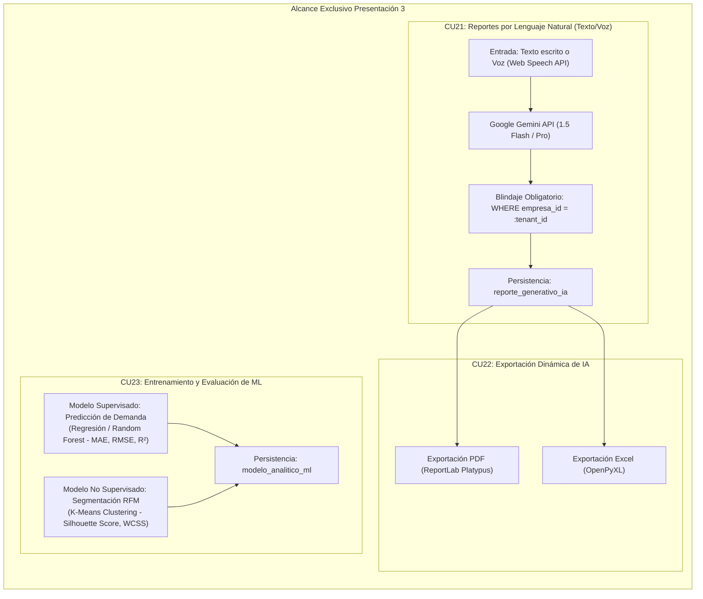

# FashionStore 2do Parcial - Skill Presentación 3: IA Generativa y Machine Learning

Esta skill proporciona la arquitectura técnica, código fuente de producción, modelos metodológicos **ICONIX** (Diagramas de Robustez BCE y Secuencia UML) y herramientas de verificación automatizada para la **Presentación 3 (Hito del 08/11/2026)** de la plataforma **FashionStore SaaS Multitenant** ante la docente **MSc. Ing. Angélica Garzón Cuéllar**.

---

## 1. Alcance Exclusivo de la Presentación 3

La Presentación 3 se concentra estrictamente en los **3 Casos de Uso de Inteligencia Artificial y Analítica Avanzada**:



### 1.1. Matriz de Casos de Uso Obligatorios de Presentación 3

| # | ID | Caso de Uso | Actor Principal | Canal | Enfoque Operativo en P3 |
| :-: | :---: | :--- | :--- | :---: | :--- |
| **1** | **CU21** | **Consultar Reportes por Lenguaje Natural (Texto/Voz)** | Admin Tenant / Gerente | Web / Móvil | Consultas asistidas por **Google Gemini** (vía texto o voz) blindadas estrictamente por `tenant_id` (ej. *"¿Cuál es la prenda más vendida en la sucursal Norte este mes?"*). |
| **2** | **CU22** | **Exportar Reportes Dinámicos de IA (Excel / PDF)** | Admin Tenant | Web | Generación y descarga estructurada en **PDF (ReportLab)** y **Excel (OpenPyXL)** de las respuestas analíticas y tablas generadas por la IA. |
| **3** | **CU23** | **Entrenar y Evaluar Modelos de Machine Learning** | Sistema / Admin SaaS | Web | Entrenamiento y métricas de evaluación con datos sintéticos: **Supervisado** (predicción de demanda de stock) y **No Supervisado** (segmentación de clientes RFM con K-Means). |

---

## 2. Reglas de Negocio y Seguridad Críticas para la Docente

> [!IMPORTANT]
> **Blindaje Multitenant Inquebrantable en IA (CU21)**:
> 1. En ningún caso una consulta en lenguaje natural puede cruzar las fronteras del tenant autenticado.
> 2. El motor Text-to-SQL debe inyectar forzosamente la cláusula `WHERE empresa_id = :tenant_id` (o filtrar a través de vistas/parámetros en el backend).
> 3. Se prohíbe terminantemente la ejecución de sentencias destructivas (`DROP`, `DELETE`, `UPDATE`, `INSERT`, `ALTER`, `TRUNCATE`). Si el modelo genera algo distinto de `SELECT`, la operación se aborta con error 400.
> 4. El Tenant con Plan Básico tiene deshabilitada la IA (`permite_ia = FALSE`), retornando `403 Forbidden: Su plan actual no cuenta con el asistente de Inteligencia Artificial`.

> [!IMPORTANT]
> **Criterios de Evaluación Docente para Machine Learning (CU23)**:
> 1. **Supervisado (Predicción de Demanda)**: Debe reportar obligatoriamente las tres métricas académicas de regresión:
>    - **MAE (Mean Absolute Error)**: Desviación promedio en unidades de prendas.
>    - **RMSE (Root Mean Squared Error)**: Penalización de errores grandes en stock.
>    - **$R^2$ (Coeficiente de Determinación)**: Bondad de ajuste explicativo ($R^2 \ge 0.70$ con datos calibrados).
> 2. **No Supervisado (Segmentación RFM con K-Means)**:
>    - Variables RFM: Recencia ($R$), Frecuencia ($F$), Valor Monetario ($M$).
>    - Validación matemática del agrupamiento: **Silhouette Score** (debe ser $> 0.25$ para validación de separación de clusters) e **Inercia (WCSS)**.
>    - Nombres pedagógicos de segmentos: *Campeones / Clientes VIP*, *Frecuentes en Crecimiento*, *Ocasionales / Nuevos*, *En Riesgo de Abandono*.

---

## 3. Arquitectura Técnica de Implementación

### 3.1. Backend (FastAPI + Python 3.11+)
- **Módulo de IA (`app/routers/ia_routes.py` y `app/services/gemini_service.py`)**:
  - Interfaz con SDK oficial `google-generativeai`.
  - Mecanismo de fallback/mock inteligente con prompts deterministas para ejecuciones en entornos offline o de test.
  - Tabla de persistencia `reporte_generativo_ia`.
- **Módulo de Exportación (`app/services/report_export_service.py`)**:
  - **PDF**: Generado con `reportlab.platypus` (`SimpleDocTemplate`, `Table`, `Paragraph`, `TableStyle`).
  - **Excel**: Generado con `openpyxl` (`Workbook`, `Font`, `PatternFill`, `Alignment`, `Border`).
- **Módulo de Machine Learning (`app/routers/ml_routes.py` y `app/services/ml_service.py`)**:
  - Modelos entrenados con `scikit-learn` (`RandomForestRegressor`, `KMeans`, `StandardScaler`).
  - Tabla de persistencia `modelo_analitico_ml`.

### 3.2. Frontend Web (Angular 17+)
- **Componente Asistente IA (`AiReportAssistantComponent`)**:
  - Input de texto con sugerencias rápidas.
  - Reconocimiento por voz mediante **Web Speech API** (`webkitSpeechRecognition`).
  - Visualización conversacional con markdown y tablas interactivas.
  - Acciones directas: 📄 `Descargar PDF` y 📊 `Descargar Excel`.
- **Componente Dashboard ML (`MlDashboardComponent`)**:
  - Panel de control para reentrenar modelos por tenant.
  - Tarjetas de métricas ($R^2$, MAE, RMSE, Silhouette Score).
  - Gráfico de dispersión y radar para perfiles RFM.

---

## 4. Guía de Ejecución Paso a Paso

Sigue esta secuencia para implementar y validar la Presentación 3:

### Paso 1: Sembrar Datos Sintéticos Realistas Multitenant
Ejecuta el script de seeding para aprovisionar historial de ventas de 90 días, clientes diferenciados y variantes de stock:
```bash
"C:\Program Files\PostgreSQL\18\pgAdmin 4\python\python.exe" .agents/skills/fashionstore-presentacion3/scripts/seed_presentation3.py
```
*(O utilizando el intérprete de Python del entorno virtual activo: `python .agents/skills/fashionstore-presentacion3/scripts/seed_presentation3.py`)*

### Paso 2: Integrar las Rutas y Servicios en FastAPI
1. Copia o referencia los esquemas y lógica completa desde [examples/fastapi_p3_ai_ml_routes.py](./examples/fastapi_p3_ai_ml_routes.py).
2. Registra los enrutadores en la aplicación principal de FastAPI:
   ```python
   app.include_router(ia_router, prefix="/api/v1/ia", tags=["IA Generativa (P3)"])
   app.include_router(ml_router, prefix="/api/v1/ml", tags=["Machine Learning (P3)"])
   ```

### Paso 3: Integrar Componentes de Frontend Angular
1. Incorpora el servicio y componentes descritos en [examples/angular_ai_ml_components.ts](./examples/angular_ai_ml_components.ts).
2. Valida la captura de audio por micrófono y la exportación de blobs binarios (`responseType: 'blob'`).

### Paso 4: Sincronizar Modelado ICONIX en Enterprise Architect
Ejecuta el script automatizado para inyectar los paquetes BCE y Secuencia de CU21, CU22 y CU23 en `diagramas_2doparcial.eap`:
```powershell
powershell -ExecutionPolicy Bypass -File .agents/skills/fashionstore-presentacion3/scripts/sync_ea_p3_iconix.ps1
```

### Paso 5: Ejecutar Suite de Pruebas Automatizadas
Verifica el cumplimiento de los 3 casos de uso al 100%:
```bash
"C:\Program Files\PostgreSQL\18\pgAdmin 4\python\python.exe" .agents/skills/fashionstore-presentacion3/scripts/verify_presentation3.py
```

---

## 5. Recursos y Referencias Incluidas en la Skill

- [Especificación ICONIX P3: BCE y Secuencia (CU21, CU22, CU23)](./references/iconix-specifications-p3.md)
- [Guía de Google Gemini NLQ, Blindaje SQL y Exportación PDF/Excel](./references/gemini-nlq-and-exports-guide.md)
- [Guía Metodológica y Matemática de Machine Learning (Supervisado y RFM)](./references/machine-learning-p3-guide.md)
- [Implementación de Referencia FastAPI (IA, Exportador y ML)](./examples/fastapi_p3_ai_ml_routes.py)
- [Implementación de Referencia Angular (Asistente Voz/Texto y Dashboard ML)](./examples/angular_ai_ml_components.ts)
- [Script de Sembrado de Datos Sintéticos P3](./scripts/seed_presentation3.py)
- [Script de Pruebas Automatizadas de Aceptación P3](./scripts/verify_presentation3.py)
- [Script de Sincronización Enterprise Architect OLEDB P3](./scripts/sync_ea_p3_iconix.ps1)
