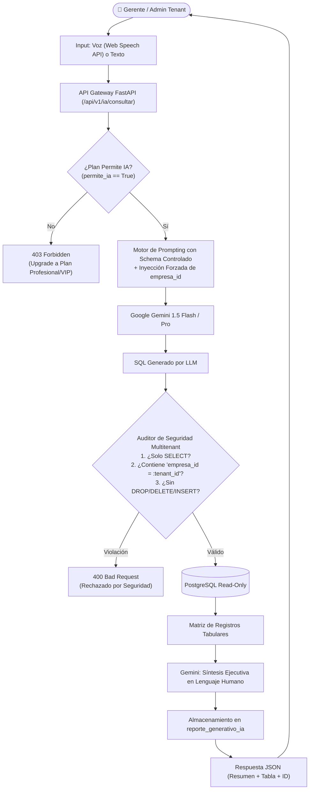

# Guía Técnica: Google Gemini NLQ, Blindaje Multitenant y Exportación PDF/Excel

Materia: **Sistemas de Información 2 (INF-412)**  
Docente: **MSc. Ing. Angélica Garzón Cuéllar**  
Componentes: **CU21 (Consultas de Lenguaje Natural) & CU22 (Exportación PDF/Excel)**

---

## 1. Arquitectura del Asistente Analítico con Google Gemini (CU21)

El asistente inteligente permite a gerentes y administradores de tiendas de moda consultar sus operaciones comerciales empleando lenguaje conversacional (texto o voz), traduciendo la intención en consultas estructuradas seguras y entregando resúmenes ejecutivos comprensibles.



---

## 2. Blindaje de Seguridad Multitenant (Criterio Crítico Docente)

Uno de los principales riesgos evaluados por la docente **MSc. Ing. Angélica Garzón Cuéllar** es el **aislamiento lógico** entre empresas en entornos SaaS. Para evitar fugas de información (*data leakage*), el sistema implementa una defensa en tres capas:

### Capa 1: Schema Contextual Acotado (System Prompt)
Solo se expone al modelo el esquema de las tablas necesarias para reportería analítica, instruyéndole taxativamente la cláusula obligatoria de pertenencia:

```text
Eres el analista de datos de FashionStore SaaS. Tu trabajo es transformar la pregunta del usuario en una consulta PostgreSQL de solo lectura (SELECT).

REGLAS DE SEGURIDAD OBLIGATORIAS:
1. SOLO puedes generar consultas SELECT. Queda estrictamente prohibido INSERT, UPDATE, DELETE, DROP, ALTER, TRUNCATE.
2. TODAS las consultas a las tablas operativas DEBEN filtrar obligatoriamente por 'empresa_id = {tenant_id}'.
3. NUNCA devuelvas contraseñas, hashes ni campos sensibles.
4. Límite máximo de registros: LIMIT 50.
5. Tablas permitidas:
   - venta (id, empresa_id, sucursal_id, fecha_venta, total, metodo_pago, estado)
   - detalle_venta (id, venta_id, producto_variante_id, cantidad, precio_unitario, subtotal)
   - producto (id, empresa_id, codigo, nombre, categoria, precio_base)
   - producto_variante (id, producto_id, talla, color, sku)
   - sucursal (id, empresa_id, nombre, ciudad)
   - inventario (id, sucursal_id, producto_variante_id, stock_actual)
```

### Capa 2: Auditor Sintáctico en Backend (Python)
Antes de enviar el SQL a la base de datos, el backend ejecuta un validador determinista:
- **Verbo Inicial**: Comprueba con expresión regular que la sentencia comience indefectiblemente con `^SELECT\b`.
- **Detección de Verbos Prohibidos**: Busca patrones de palabras clave destructivas (`DROP`, `DELETE`, `UPDATE`, `INSERT`, `ALTER`, `GRANT`, `REVOKE`, `--`, `/*`).
- **Verificación de Inyección del Tenant**: Valida que el texto de la consulta contenga la cadena literal `empresa_id = {tenant_id}` o `empresa_id={tenant_id}`. Si no la contiene, el backend la inyecta programáticamente o cancela la transacción.

### Capa 3: Transacción Read-Only con Timeout
La conexión a base de datos para responder consultas de IA se configura como:
```python
session.execute(text("SET TRANSACTION READ ONLY;"))
session.execute(text("SET statement_timeout = '5000ms';"))  # Máximo 5 segundos
```

---

## 3. Manejo de Entrada por Voz (Web Speech API)

En el cliente (Angular / Flutter Móvil), el usuario puede interactuar con su voz. En navegadores web, se aprovecha la API nativa del navegador:

```typescript
// Integración con SpeechRecognition
const recognition = new (window.SpeechRecognition || window.webkitSpeechRecognition)();
recognition.lang = 'es-BO'; // Español de Bolivia / América Latina
recognition.continuous = false;
recognition.interimResults = false;

recognition.onresult = (event) => {
  const transcript = event.results[0][0].transcript;
  this.enviarConsulta(transcript, 'VOZ');
};
```

---

## 4. Exportación Dinámica a PDF con ReportLab (CU22)

Para la generación de reportes ejecutivos descargables en PDF, se utiliza la librería profesional **ReportLab Platypus**:

### Estructura del Documento:
1. **Encabezado Institucional**:
   - Logotipo y Razón Social del Tenant.
   - NIT y Dirección Fiscal.
   - Fecha de emisión, usuario solicitante y canal de consulta (`TEXTO` o `VOZ`).
2. **Sección de Pregunta y Síntesis**:
   - Tarjeta destacada con la pregunta del gerente.
   - Resumen analítico generado por Gemini en párrafos justificados.
3. **Tabla de Datos Estructurada**:
   - Encabezados con fondo azul oscuro (`#1E3A8A`) y texto blanco en negrita.
   - Filas alternadas con fondo gris suave (`#F3F4F6` - efecto cebra).
   - Alineación de números y montos monetarios a la derecha (`#Bs. 0.00`).
4. **Pie de Página Dinámico**:
   - Numeración de páginas `"Página X de Y"`.
   - Marca de agua o sello de certificación multitenant FashionStore.

---

## 5. Exportación Dinámica a Excel con OpenPyXL (CU22)

Para permitir a los contadores y gerentes profundizar en los datos, se genera un libro XLSX con formato empresarial utilizando **OpenPyXL**:

### Estructura de la Hoja:
- **Fila 1 (Título)**: Razón Social de la Empresa (Fuentecilla Arial 14pt, Negrita, fondo `#1E3A8A`, fuente blanca, celdas combinadas `A1:E1`).
- **Fila 2 (Subtítulo)**: Consulta analítica ejecutada y fecha de corte.
- **Fila 4 (Cabecera de Tabla)**: Nombres de columnas estilizados con bordes finos, fondo gris azulado y filtros automáticos habilitados (`ws.auto_filter.ref`).
- **Filas de Datos**: Datos con tipos tipados (números enteros como `int`, monedas como `float` con formato numérico `#,##0.00`, fechas con `YYYY-MM-DD`).
- **Fila de Totales**: Inserción de la función `=SUM(...)` en columnas numéricas para recalcular montos al editar.
- **Autoajuste de Ancho**: Iteración sobre cada columna calculando `max(len(str(val))) + 3` para evitar celdas recortadas o con `###`.
