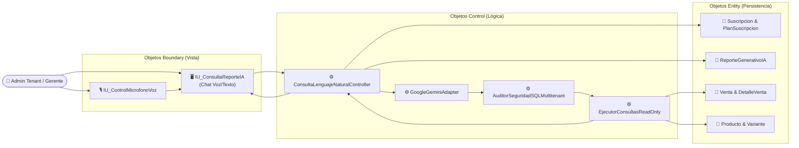
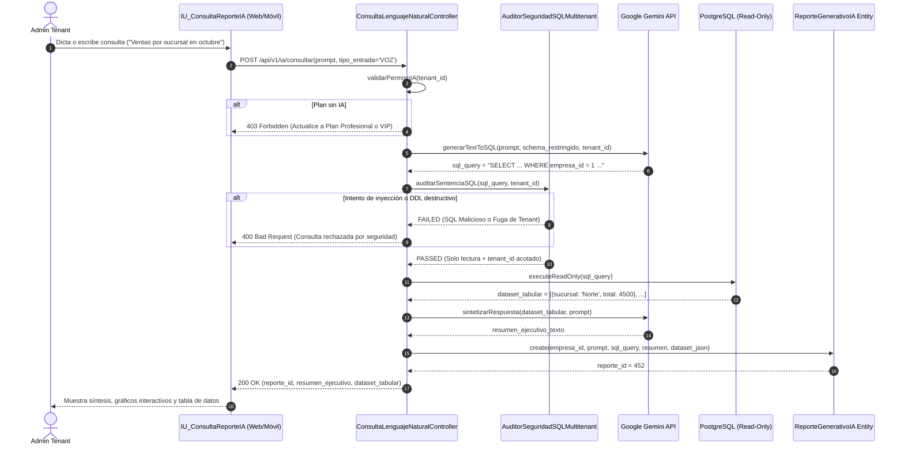
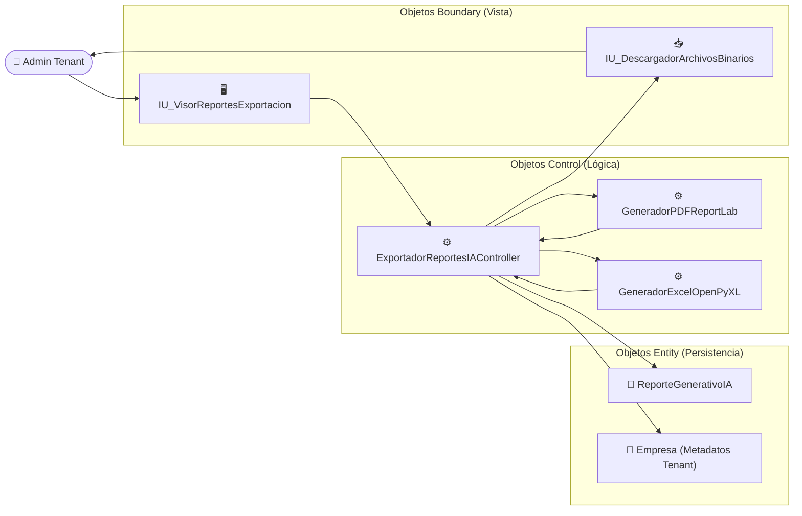
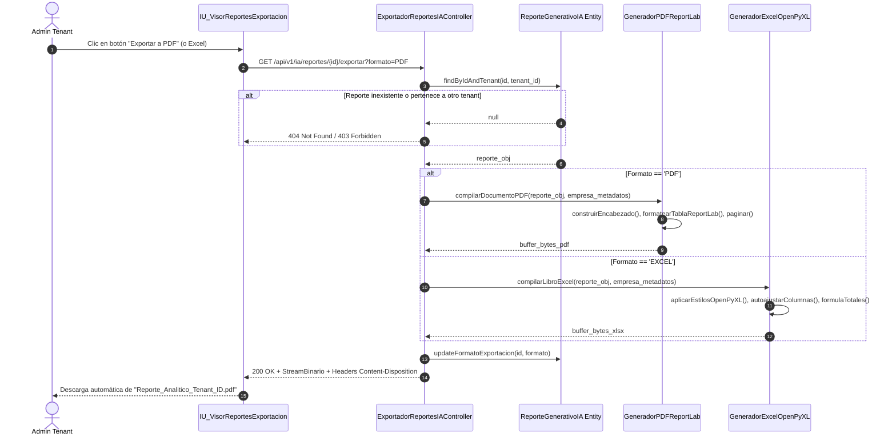
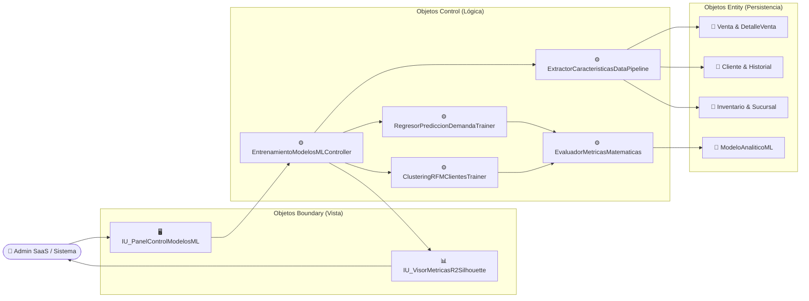
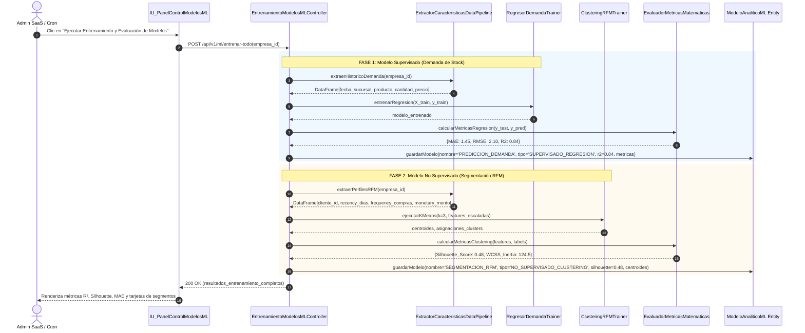

# Especificaciones ICONIX: Análisis de Robustez (BCE) y Secuencia UML (Presentación 3)

Materia: **Sistemas de Información 2 (INF-412)**  
Docente: **MSc. Ing. Angélica Garzón Cuéllar**  
Fase: **Presentación 3 (Hito 08/11/2026) - IA Generativa y Machine Learning**

---

## 1. Fundamentos ICONIX Aplicados a la Presentación 3

En la metodología ICONIX, los diagramas de robustez sirven de puente entre la semántica del caso de uso ("qué debe hacer el sistema") y el diseño detallado de clases y secuencias ("cómo lo implementa la arquitectura").

Se aplican con rigurosidad las **4 Reglas de Robustez BCE**:
1. Los **Actores** solo se comunican con objetos **Boundary** (interfaces de usuario, controladores de voz o API gateways).
2. Los objetos **Boundary** solo se comunican con **Controllers** y Actores.
3. Los **Controllers** orquestan la lógica: pueden comunicarse entre sí, con Boundaries y con Entities.
4. Las **Entities** (tablas y registros de persistencia) nunca interactúan directamente con Boundaries; su acceso está mediado por Controllers.

---

## 2. Especificación Detallada de los 3 Casos de Uso

---

### CU21: Consultar Reportes por Lenguaje Natural (Texto/Voz)

- **ID**: `CU21`
- **Nombre**: Consultar Reportes por Lenguaje Natural (Texto/Voz)
- **Actores**: Administrador del Tenant / Gerente de Sucursal
- **Canal**: Aplicación Web / Aplicación Móvil
- **Precondiciones**:
  1. Usuario autenticado con contexto empresarial válido (`empresa_id`).
  2. La empresa cuenta con suscripción activa cuyo plan permite analítica de IA (`plan_suscripcion.permite_ia = TRUE`).
- **Postcondiciones**:
  1. Se genera una respuesta analítica sintetizada con tablas y cifras explicativas.
  2. La consulta, el SQL generado y el resultado quedan registrados en `reporte_generativo_ia`.

#### Flujo Principal:
1. El usuario accede al asistente conversacional inteligente.
2. El usuario introduce su requerimiento comercial:
   - **Opción A (Texto)**: Escribe una pregunta analítica (ej. *"¿Cuáles fueron las 5 prendas más vendidas en la sucursal Norte durante el último mes?"*).
   - **Opción B (Voz)**: Presiona el botón del micrófono, dicta su consulta verbalmente y el transcriptor del cliente (Web Speech API / Gemini Audio) genera el texto transcrito.
3. La interfaz envía el texto, el tipo de entrada (`TEXTO` o `VOZ`) y el token JWT al backend.
4. El controlador backend valida que la suscripción del tenant admita IA.
5. El controlador invoca el servicio de IA con el System Prompt que contiene:
   - Esquema de base de datos permitido (tablas: `venta`, `detalle_venta`, `producto`, `sucursal`, `inventario`).
   - Regla de inyección forzosa: La consulta SQL generada **debe** incluir `WHERE empresa_id = :tenant_id`.
6. El modelo LLM (Google Gemini) analiza la semántica y retorna una sentencia `SELECT` segura junto con el razonamiento.
7. El controlador intercepta el SQL generado y ejecuta una validación de seguridad:
   - Verifica que sea estrictamente de tipo `SELECT`.
   - Verifica que contenga el filtro `empresa_id = <id_del_tenant>`.
8. El sistema ejecuta la consulta SQL en PostgreSQL bajo una transacción de solo lectura con timeout.
9. El resultado tabular se le envía nuevamente a Gemini para obtener una síntesis ejecutiva en lenguaje natural.
10. Se guarda el historial en la entidad `reporte_generativo_ia`.
11. La interfaz muestra la síntesis, las métricas clave y la tabla interactiva de resultados con opciones de exportación inmediata.

#### Flujos Alternativos y Excepciones:
- **4a. Plan sin soporte para IA**: Si el plan es `BASICO`, el controlador responde `403 Forbidden: La analítica con Inteligencia Artificial no está incluida en su plan de suscripción`.
- **7a. Consulta maliciosa o no autorizada**: Si el SQL intentado incluye verbos DML/DDL (`DELETE`, `UPDATE`, `DROP`, `INSERT`) o no incluye el filtro de tenant, el controlador aborta inmediatamente y retorna error `400 Bad Request: Consulta no permitida por políticas de seguridad multitenant`.
- **8a. Sin datos para el período solicitado**: Si el `SELECT` devuelve cero registros, Gemini formula una respuesta cortés indicando la ausencia de operaciones en dicho rango y sugiere ajustar los filtros temporales.

#### Diagrama de Robustez BCE (CU21):

#### Diagrama de Secuencia UML (CU21):

---

### CU22: Exportar Reportes Dinámicos de IA (Excel / PDF)

- **ID**: `CU22`
- **Nombre**: Exportar Reportes Dinámicos de IA (Excel / PDF)
- **Actores**: Administrador del Tenant
- **Canal**: Aplicación Web
- **Precondiciones**:
  1. Debe haberse emitido una consulta analítica previa y existir su registro en `reporte_generativo_ia`.
  2. El usuario debe pertenecer a la empresa propietaria del reporte (`empresa_id`).
- **Postcondiciones**:
  1. El cliente recibe un flujo binario descargable (`application/pdf` o `application/vnd.openxmlformats-officedocument.spreadsheetml.sheet`).
  2. Se actualiza el campo `formato_exportacion` en la base de datos para auditoría.

#### Flujo Principal:
1. El usuario visualiza en pantalla un reporte generado previamente por la IA.
2. El usuario selecciona la acción deseada:
   - **Opción A: Exportar PDF**: Para presentaciones impresas y reuniones ejecutivas.
   - **Opción B: Exportar Excel**: Para análisis contable y manipulación de datos en hojas de cálculo.
3. La interfaz web solicita la exportación invocando el endpoint con el identificador del reporte (`reporte_id`) y el formato seleccionado.
4. El controlador backend verifica el aislamiento multitenant: confirma que `reporte.empresa_id == usuario.empresa_id`.
5. Según el formato solicitado:
   - **Si es PDF (ReportLab)**:
     a. Inicializa el documento con Platypus `SimpleDocTemplate` en tamaño Carta/A4.
     b. Inserta el encabezado institucional: Razón Social de la empresa, NIT, fecha y hora de emisión, y el prompt que dio origen al reporte.
     c. Inserta el resumen analítico generado por Gemini en un bloque de párrafo estilizado.
     d. Construye una tabla `Table` con los datos estructurados, alternando colores de fila (estilo cebra), alineación monetaria a la derecha y encabezados en azul marino.
     e. Genera la numeración de páginas y el pie de página con sello de trazabilidad.
   - **Si es Excel (OpenPyXL)**:
     a. Crea un nuevo `Workbook` y selecciona la hoja activa.
     b. Aplica estilos corporativos: Título combinado en negrita con fondo azul corporativo, subtítulo con el prompt del usuario.
     c. Escribe las cabeceras de columnas con fuente blanca en negrita sobre fondo oscuro.
     d. Vuelca los registros tabulares con formato numérico adecuado (monedas con decimales `#,##0.00`, fechas formateadas).
     e. Inserta fila final de totales automáticos (`=SUM(...)`) cuando aplique a columnas cuantitativas.
     f. Ajusta dinámicamente el ancho de las columnas según la longitud máxima de los datos.
6. El controlador actualiza `formato_exportacion` en `reporte_generativo_ia`.
7. El controlador retorna la respuesta binaria con cabeceras `Content-Disposition: attachment; filename="reporte_ia_YYYYMMDD.xxx"`.
8. El navegador web del usuario descarga automáticamente el archivo listo para abrir.

#### Diagrama de Robustez BCE (CU22):

#### Diagrama de Secuencia UML (CU22):

---

### CU23: Entrenar y Evaluar Modelos de Machine Learning

- **ID**: `CU23`
- **Nombre**: Entrenar y Evaluar Modelos de Machine Learning
- **Actores**: Sistema (Proceso Programado) / Administrador SaaS
- **Canal**: Aplicación Web
- **Precondiciones**:
  1. Base de datos con historial transaccional de ventas, detalles de pedido y stock por sucursal (mínimo 50 registros para aprendizaje válido).
  2. Parámetros de hiper-entrenamiento definidos o por omisión.
- **Postcondiciones**:
  1. Se ajustan y persisten los parámetros de los modelos en `modelo_analitico_ml`.
  2. Se calculan y registran las métricas formales de precisión ($R^2$, MAE, RMSE para supervisado; Silhouette Score e Inercia para no supervisado).

#### Flujo Principal:
1. El Administrador SaaS (o un cron de mantenimiento nocturno) solicita la ejecución del pipeline de analítica de datos.
2. El controlador backend recibe la orden e inicia la fase de extracción de datos:
   - **Pipeline 1: Aprendizaje Supervisado (Predicción de Demanda de Stock)**:
     a. Extrae la matriz histórica de transacciones agrupadas por fecha, sucursal y variante de prenda textil.
     b. Realiza ingeniería de características: extracción del día de la semana, mes, indicador de fin de semana, precio unitario y demanda en unidades.
     c. Divide el dataset en subconjuntos de entrenamiento ($80\%$) y prueba ($20\%$).
     d. Entrena un modelo de regresión (`RandomForestRegressor` o `RidgeRegression`).
     e. Evalúa las predicciones sobre el conjunto de prueba y calcula las métricas requeridas:
        - **$MAE$** (Error Absoluto Medio)
        - **$RMSE$** (Raíz del Error Cuadrático Medio)
        - **$R^2$** (Coeficiente de Determinación)
     f. Almacena el modelo y sus métricas en `modelo_analitico_ml` con `tipo_aprendizaje = 'SUPERVISADO_REGRESION'`.
   - **Pipeline 2: Aprendizaje No Supervisado (Segmentación RFM de Clientes)**:
     a. Extrae para cada cliente de la empresa las tres métricas del modelo RFM:
        - **Recency ($R$)**: Días transcurridos desde su última compra.
        - **Frequency ($F$)**: Conteo total de transacciones completadas.
        - **Monetary ($M$)**: Suma total monetaria facturada por el cliente.
     b. Normaliza y escala las variables con `StandardScaler` para evitar sesgo por magnitud.
     c. Ejecuta el algoritmo de agrupamiento **K-Means** para $k \in [3, 5]$ clusters.
     d. Calcula el **Silhouette Score** del agrupamiento y la **Inercia / WCSS**.
     e. Asigna a cada cluster su etiqueta semántica de negocio (*VIP*, *Frecuente*, *Ocasional*, *En Riesgo*).
     f. Almacena los centroides y métricas en `modelo_analitico_ml` con `tipo_aprendizaje = 'NO_SUPERVISADO_CLUSTERING'`.
3. El sistema marca los modelos como vigentes (`activo = TRUE`).
4. La interfaz presenta al usuario un dashboard ejecutivo con tarjetas de métricas, gráficas de dispersión de clusters y predicciones proyectadas de stock.

#### Diagrama de Robustez BCE (CU23):

#### Diagrama de Secuencia UML (CU23):

