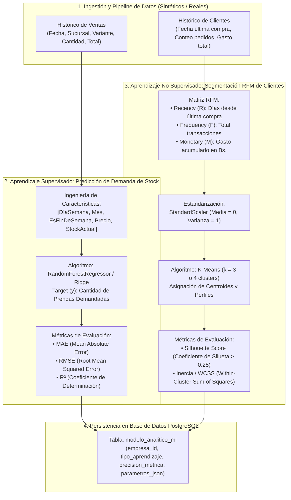

# Guía de Machine Learning: Modelos Supervisado y No Supervisado (CU23)

Materia: **Sistemas de Información 2 (INF-412)**  
Docente: **MSc. Ing. Angélica Garzón Cuéllar**  
Componente: **CU23 (Entrenar y Evaluar Modelos de Machine Learning)**

---

## 1. Visión Metodológica del Módulo de Machine Learning

Para la Presentación 3, la cátedra requiere la integración de dos vertientes fundamentales del aprendizaje automático sobre el dominio de tiendas textiles de moda:



---

## 2. Modelo Supervisado: Predicción de Demanda de Stock

### 2.1. Formulación del Problema
Predecir la cantidad de prendas demandadas ($y \in \mathbb{R}^+$) para una variante de producto en una sucursal específica durante un día determinado, permitiendo al encargado de almacén anticipar quiebres de inventario o planificar traspasos multi-sucursal preventivos.

### 2.2. Vector de Características ($X$)
Para cada observación histórica se extrae:
1. `dia_semana`: Día de la semana (0 = Lunes, ..., 6 = Domingo) capturando la estacionalidad semanal (alta demanda viernes-domingo).
2. `mes`: Mes del año (1 a 12) capturando cambios de temporada (verano/invierno, festividades).
3. `es_fin_de_semana`: Variable binaria (1 si es sábado/domingo, 0 caso contrario).
4. `precio_unitario`: Precio de venta de la prenda.
5. `sucursal_id`: Código de la tienda.
6. `categoria_id`: Categoría textil (ej. Vestidos, Pantalones, Blusas).

### 2.3. Algoritmo y Entrenamiento
Se emplea un conjunto ensamblado **Random Forest Regressor** (o Regresión Lineal Regularizada) mediante `scikit-learn`:
- **División de datos**: 80% entrenamiento, 20% prueba (`train_test_split(test_size=0.2, random_state=42)`).
- **Parámetros**: `n_estimators=100`, `max_depth=8`.

### 2.4. Métricas Matemáticas de Evaluación Obligatorias

1. **Error Absoluto Medio (MAE)**:
   $$\text{MAE} = \frac{1}{n} \sum_{i=1}^n |y_i - \hat{y}_i|$$
   *Interpretación docente*: Mide el desvío promedio en unidades directas de prendas respecto a la realidad.

2. **Raíz del Error Cuadrático Medio (RMSE)**:
   $$\text{RMSE} = \sqrt{\frac{1}{n} \sum_{i=1}^n (y_i - \hat{y}_i)^2}$$
   *Interpretación docente*: Penaliza de manera más severa errores grandes de predicción, evitando quiebres severos de stock.

3. **Coeficiente de Determinación ($R^2$)**:
   $$R^2 = 1 - \frac{\sum_{i=1}^n (y_i - \hat{y}_i)^2}{\sum_{i=1}^n (y_i - \bar{y})^2}$$
   *Interpretación docente*: Proporción de la varianza de la demanda explicada por el modelo ($0.0 \le R^2 \le 1.0$). Un valor $\ge 0.70$ denota un modelo sólido para la defensa.

---

## 3. Modelo No Supervisado: Segmentación de Clientes RFM con K-Means

### 3.1. Formulación del Problema
Agrupar a la base de clientes del tenant en segmentos estratégicos homogéneos según sus patrones de consumo histórico, sin requerir etiquetas previas de entrenamiento.

### 3.2. Métricas del Modelo RFM
Para cada cliente $i$, se calculan tres variables respecto a una fecha de referencia:
- **Recency ($R$)**: Número de días transcurridos desde su última transacción:
  $$R_i = \text{Fecha\_Referencia} - \max(\text{Fecha\_Venta}_i)$$
- **Frequency ($F$)**: Número total de compras completadas en la tienda:
  $$F_i = \sum \mathbf{1}_{\{\text{Ventas del cliente } i\}}$$
- **Monetary ($M$)**: Suma total monetaria gastada por el cliente:
  $$M_i = \sum \text{Monto\_Total}_{i}$$

### 3.3. Estandarización de Variables
Dado que $M$ oscila en cientos o miles de pesos/dólares mientras que $F$ oscila en unidades pequeñas, es indispensable normalizar las variables con `StandardScaler`:
$$z = \frac{x - \mu}{\sigma}$$
Garantizando que las distancias euclidianas no queden dominadas por el monto económico.

### 3.4. Algoritmo K-Means y Definición de Clusters
Se configura K-Means con $k = 3$ o $k = 4$ clusters inicializados mediante el método `k-means++`.

#### Interpretación de Perfiles de Negocio:
| Cluster | Nombre Semántico | Características RFM | Acción Sugerida |
| :---: | :--- | :--- | :--- |
| **0** | **Clientes VIP / Campeones** | Bajo $R$ (recientes), Alto $F$ (frecuentes), Alto $M$ (alto gasto) | Trato preferencial, acceso anticipado a nuevas colecciones. |
| **1** | **Compradores Ocasionales** | Alto $R$ (hace tiempo), Bajo $F$, Medio/Bajo $M$ | Campañas de reactivación y cupones de descuento. |
| **2** | **Nuevos Clientes Prometedores** | Muy bajo $R$ (compra reciente), Bajo $F$ (1 compra), Buen $M$ | Mensajes de bienvenida y fidelización inmediata. |

### 3.5. Métricas Matemáticas de Evaluación

1. **Silhouette Score (Coeficiente de Silueta)**:
   $$s(i) = \frac{b(i) - a(i)}{\max(a(i), b(i))}$$
   Donde $a(i)$ es la distancia intra-cluster media y $b(i)$ es la distancia media al cluster vecino más cercano.
   - El promedio global de silueta $S \in [-1, 1]$.
   - Un valor $S > 0.35$ certifica que los clusters están bien delimitados y no se superponen.

2. **Inercia / WCSS (Within-Cluster Sum of Squares)**:
   $$\text{WCSS} = \sum_{k=1}^K \sum_{x \in C_k} ||x - \mu_k||^2$$
   Utilizada para justificar la elección de $k$ mediante el **Método del Codo**.

---

## 4. Persistencia del Modelo en Base de Datos

Cada sesión de entrenamiento almacena una tupla en `modelo_analitico_ml`:
```sql
INSERT INTO modelo_analitico_ml (
    empresa_id,
    nombre_modelo,
    tipo_aprendizaje,
    variable_objetivo,
    precision_metrica,
    parametros_json,
    fecha_entrenamiento,
    activo
) VALUES (
    1,
    'PREDICCION_DEMANDA_STOCK_RF',
    'SUPERVISADO_REGRESION',
    'cantidad_prendas_demandadas',
    0.8420,  -- R² Score
    '{"mae": 1.42, "rmse": 2.11, "n_estimadores": 100, "algoritmo": "RandomForestRegressor"}',
    CURRENT_TIMESTAMP,
    TRUE
);
```
